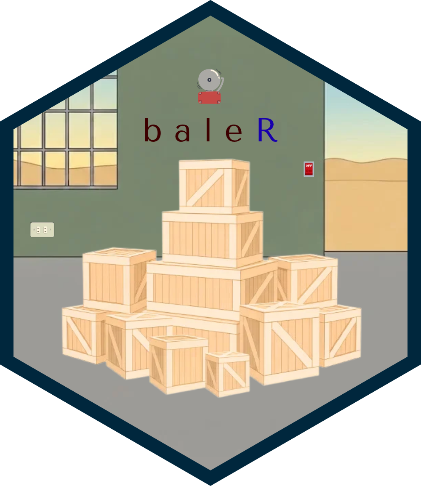

# baler 

[](https://github.com/baler-dev/baler/actions/workflows/build.yml)
[](https://github.com/baler-dev/baler/actions/workflows/test.yml)
[](https://github.com/baler-dev/baler/releases)
[](https://github.com/baler-dev/baler/blob/main/LICENSE.md)

A module manager for [{box}](https://klmr.me/box/) modules.

`{baler}`, formerly [`{carrier}`](https://github.com/joshuamarie/carrier), is another package manager for R, built in Rust, exclusive for `{box}` modules — call them `box-bale` modules for now. The tasks it handles involve bundling and installation. The entire purpose of `{baler}` is to make the packaging for `{box}` modules possible and to be easily distributed. The interface of `{baler}` is similar to that Python's `pip` or `conda`, or Rust's `{cargo}` itself. Visit the following docs:

-  [The official docs](https://klmr.me/box/)
-  [The book](https://modules-in-r.joshuamarie.com/)

To get an explanation of how `{box}` modules work. 

## Installation

`{baler}` is a Rust package with thin wrapper command line interface (CLI) tool built in Rust. Pre-built binaries for Linux, MacOS, and Windows is available on the [Releases](https://github.com/baler-dev/baler/releases).

You can install `baler` using the Shell installers. 

1.  On Linux / macOS:

    ``` bash
    curl -sSL https://raw.githubusercontent.com/baler-dev/baler/refs/heads/main/scripts/install.sh | bash
    ```

2.  On Windows: 

    ``` bash
    powershell -ExecutionPolicy Bypass -c "irm https://raw.githubusercontent.com/baler-dev/baler/refs/heads/main/scripts/install.ps1 | iex"
    ```

To install the specific version, use that version's URL instead of `latest`: 

``` bash
curl -LsSf https://github.com/baler-dev/baler/releases/download/v0.1.0/baler-installer.sh | bash
```

``` bash
powershell -ExecutionPolicy Bypass -c "irm https://github.com/baler-dev/baler/releases/download/v0.1.0/baler-installer.ps1 | iex"
```

To install the development version of `{baler}` from GitHub, one requires [Rust](https://www.rust-lang.org/tools/install) (stable toolchain), particularly toolchains namely `rustc` and `cargo` on your system to compile it from source.

``` bash
cargo install --git https://github.com/baler-dev/baler
```

Then install the particular primary `{box}` R package to load the `{box}`-`{baler}` modules. In a meantime, kindly install the package from the forked repo, as the patches for `{baler}` support are written down there and hasn't made in its upstream yet, so do the following:

``` r
# Install the package through GitHub
# This needs compilation BTW
# To build the package
# install.packages('pak')
pak::pak("joshuamarie/box@feature/baler-support")
```

## Requirements

The idea for distributable `{box}` modules is simple, really — you just need few requirements. Similar to Python and R packages, the usual structure of `box-bale` modules ALWAYS has the metadata called `baler.toml`, and analogue of `DESCRIPTION` of R packages or `pyproject.toml` of Python packages. Then, the `__init__.r` file serves as an entry point of the modules. You need this as it is similar to `NAMESPACE` from traditional CRAN-style packages.  

Here's an example structure of the module: 

```
<some-dir-name>/
├── baler.toml   
├── README.md
└── <src-folder>/
    ├── __init__.r
    ├── mod.r
    ├── mod2.r
    └── <submod>/
        ├── __init__.r
        ├── example.r
        └── ...
```

And the structure can go deeper than this. If you know the structure of Python packages, this feels familiar to you. 

## CLI Usage: How it works

`{baler}` has few commands that you need to know as a starter to manage the modules. 

*Note: `<name-of-the-module>` is a placeholder. Apply a valid name.*

1.  Either initiate an R module with `baler.toml` metadata file by own, or use `baler init <name-of-the-module>` command: 

    ``` bash
    baler init <name-of-the-module>
    ```

    *Here are more [details](https://baler-dev.github.io/baler/reference/cli.html#the-current-directory) when `baler init` has an empty argument.* 

2.  Bundle the module from the top of the directory with:

    ``` bash
    baler bundle .
    ```

    No need to pass any argument, especially `.`, since the default `<path>` argument is the current directory `.`, no additional flags to be passed.

3.  Install from an archive, a local project directory, or GitHub:

    ``` bash
    baler install --path path/of/the/module_0.1.0.tar.gz
    baler install --path .
    baler install --git https://github.com/username/repo
    ```

    *Note: Running `baler install <module>`, where `<module>` is just a bare name, no prefixes or whatsoever, is valid but reserved for installation of packages from a registry or a remote repository. `{baler}` is still at its early stage, and I would like to hear words from you, feedback is very welcome. Also, there are plenty of ways to install a module from a GitHub repo, so please read the [docs](https://baler-dev.github.io/baler/reference/cli.html#module-installation) to know more. *

4.  Remove the installed module

    ``` bash
    baler remove <name-of-the-module>
    ```

5.  Optional: Pin those R package versions so later installs reproduce them:

    ``` bash
    baler lock .
    ```

## Using installed modules

There are patches along the source code of `{box}`. This way, the modules managed by `{baler}` syncs with `{box}` R package (this inherits the whole semantics, including the syntax). The `box::use()` call automatically resolves the path where the installed `box-bale` modules belong.

Try `{convert}` module, which belongs to `convert-proj` from the `examples/`: 

``` r
# baler install --git https://github.com/baler-dev/baler --module-dir examples/modules/convert-proj
box::use(cv = convert)
cv$mass$mass_conversion_table(1000)
#>
#>  Mass conversion table for 1000 kg
#>  -----------------------------------
#>  mg         : 1e+09
#>  g          : 1e+06
#>  kg         : 1000
#>  t          : 1
#>  oz         : 35274
#>  lb         : 2204.62
#>  st         : 157.473
#>  ton_us     : 1.10231
#>  ct         : 5e+06
#>  amu        : 6.02214e+29
#>  -----------------------------------
#>
```
